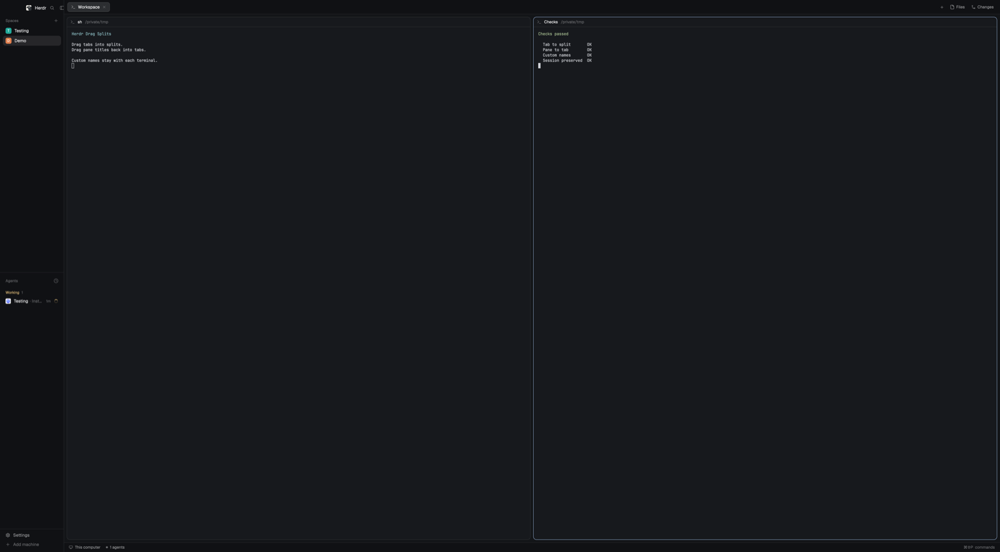

# My Herdr config

This repository **is the live `~/.config/herdr-app` folder**. Herdr reads the tracked files directly, so edits to the UI happen in this Git checkout. Commit and push those changes to sync them to GitHub; pull on another machine to bring them across. There is no separate install or copy step after setup.

The custom **drag-splits** layout adds tab-to-split dragging, pane-to-tab dragging and custom-name preservation. A full-window translucent overlay highlights the destination in light grey, without arrows or circles. Side drop zones cover the full height.



## Set up on another machine

Requires Git, Python 3 on PATH, [Herdr](https://herdr.dev) and Herdr Core (`hc`). Tested on macOS with Herdr **0.1.16**. The same config path is used on Linux, but Linux has not been tested. This setup is intended for macOS and Linux.

1. Install Herdr and open it once to finish setting up its core. Install Python 3 if necessary (`brew install python` on macOS).
2. **Quit the Herdr window** before replacing its config folder. Run the following from another terminal. Existing configuration is preserved in a timestamped backup.

   ```sh
   git clone https://github.com/EthanHosier/herdr-config.git "$HOME/.config/herdr-app-checkout"
   backup="$HOME/.config/herdr-app.backup-$(date +%Y%m%d-%H%M%S)"
   mv "$HOME/.config/herdr-app" "$backup"
   mv "$HOME/.config/herdr-app-checkout" "$HOME/.config/herdr-app"
   ```

3. Open Herdr again. It will regenerate its built-in mods, icons and runtime files; Git ignores these. Then activate the custom layout:

   ```sh
   ~/.local/bin/herdr-app do layout.switch '{"name":"drag-splits"}'
   ```

   If installed elsewhere, run `herdr-app` from PATH instead. You can also select **drag-splits** in Herdr's layout settings.

The repo includes `settings.json` and `keys.json`, so it carries the current preferences and shortcuts too, including 12px terminal text. The custom mods require `python3`, `herdr-app` and `hc`; the move helper also looks for Herdr CLIs under `~/.local/bin`.

For a second computer that should also push changes, use your own GitHub account's repository access, or fork the repo and clone your fork.

## Save future changes

Edits made by an agent or through Herdr settings land directly in this checkout. To publish them:

```sh
cd ~/.config/herdr-app
git status --short
git diff
git add -A
git commit -m "Update Herdr UI"
git push
```

On another configured machine:

```sh
cd ~/.config/herdr-app
git pull --ff-only
```

Most UI changes reload live. Commit local changes before pulling; if both machines changed the same files, resolve the conflict before continuing. Git does **not** commit, push or pull automatically.

New custom mods, layouts and themes are tracked by default. The `.gitignore` excludes Herdr's current shipped files, generated types, session state, window positions, telemetry and caches. New built-in mods introduced by a Herdr update may need an ignore entry. Review `git status` before publishing, particularly if you add credentials, private URLs or machine-specific paths to your own mods or settings.

## Use the layout

**New tabs:** only the tab right-click menu’s **New tab** action opens Codex in YOLO mode (approvals and sandboxing disabled) in this layout. The top-bar **+** opens the tab-type selector. **Cmd+T** retains its original plain-terminal behavior. The launcher uses the configured Codex command from Herdr’s program table, defaulting to `codex` resolved by the target machine’s shell. It does not select a ChatGPT-bundled binary automatically. The launcher removes `--no-daemon` from Herdr’s suggested command, keeping Codex’s normal daemon behavior.

- **Tab → split:** select the destination tab, then drag another tab downward into the workspace. Release in the left, right, upper or lower highlighted section. If dragging the active tab, another tab in the same space becomes the destination.
- **Split → tab:** drag a pane's title upward and release in the overlay's top strip. Use the title rather than Herdr's native top-center grip, which rearranges existing panes.
- **Agent notes:** right-click a terminal or its title bar and choose **Show notes** / **Hide notes**, directly above **Split right**. Plain-text notes appear inside the expanded pane header and are always directly editable. Text saves automatically; hiding notes does not delete it. There is no separate notes pane to move.
- **Cancel:** press Escape or release in an unhighlighted section.

Custom names follow the terminal through repeated moves and appear in pane headers. Metadata is stored on the live terminal as `herdr.drag-tab-name`, outside this repo.

Tab-to-split moves support **single-terminal tabs in the same space**, including their optional header notes. Detaching currently requires at least two terminal panes. Notes are part of the terminal’s header, so native pane dragging, swaps, and tab/split transfers keep them with the agent automatically. Moving whole split trees, cross-space transfers and unrelated mod-panel transfers are not supported. These are personal clones, so Herdr updates do not overwrite them, but future app releases may require compatibility updates.

### Notes persistence

Notes belong to the live terminal, rather than a tab ID or split-pane ID. Visibility is stored as the terminal’s `herdr.notes-header` label. A stable UUID is kept as its `herdr.notes-id` label. Text is autosaved in this Herdr window’s local `shared.json`, under `agent-notes.text.<UUID>`. This survives layout switches, reloads, app restarts, hiding/showing, and our tab/split moves while retaining the terminal’s identity. Two agents have separate notes. Closing an agent retains its saved text in local state, but new terminals do not automatically inherit old notes. Older companion notes are closed and migrated when toggled, preserving their text.

**Header sizing:** Herdr shares header height across panes in a layout. The header expands to 190px while any notes are shown in the active tab, and returns to 30px when none are shown. Other panes in that tab reserve the same header height even when their own notes are hidden.

**Note contents are private local state and are excluded from Git.** Cloning this repo on another computer transfers the notes UI, not note contents. Remote terminals use the same UI feature, but the text is saved on the computer running the Herdr window; cross-computer note synchronization is not implemented.

## If a new tab launches a different Codex

On the machine where you expect Codex to run, compare `type -a codex` and `codex --version` in a plain terminal. Herdr loads the target machine’s shell configuration, but its agent launcher does not expand shell aliases. Use a shell function or executable wrapper if your normal `codex` command is an alias. Alternatively, add a `run` array to the existing `programs.codex` entry in `programs.json`, for example `"run": ["/path/to/preferred/codex"]`. Preserve the icon fields. That path must exist on every machine where the launcher is used, so a wrapper named on PATH is usually easier to share between machines.

A Herdr remote space created through **Settings → Machines** launches new tabs on that remote machine. Typing `ssh` inside a local terminal does not make its Herdr space remote: new tabs still start locally. In that case, add the host through Herdr Machines and create/select a space on it.

The context-menu launcher adds only the YOLO mode flag, `--dangerously-bypass-approvals-and-sandbox`, and removes `--no-daemon` if Herdr suggests it. This keeps the usual Codex daemon behavior with YOLO permissions.

## Files

| Path | Purpose |
| --- | --- |
| `layouts/drag-splits.json` | Custom layout based on Herdr's main layout |
| `layouts/drag-splits.svg` | Layout settings preview |
| `mods/drag-tabs/` | Tab bar and tab-to-split dragging |
| `mods/codex-tab-menu/` | Tab context menu with Codex as the New tab action |
| `mods/drag-pane/` | Pane headers, inline plain-text notes and pane-to-tab dragging |
| `mods/tab-drop/` | Drop overlay and Python helper for terminal moves, header visibility and legacy-note migration |
| `mods/agent-notes/` | Legacy editor retained to safely migrate older saved notes panes |
| `settings.json`, `keys.json` | Personal preferences and shortcuts |
| `programs.json`, `my-icons/` | Codex icon override using the OpenAI logo |
| `.gitignore` | Keeps generated files and runtime state local |

Validate after editing mods:

```sh
herdr-app check ~/.config/herdr-app/mods/drag-tabs
herdr-app check ~/.config/herdr-app/mods/drag-pane
herdr-app check ~/.config/herdr-app/mods/tab-drop
herdr-app check ~/.config/herdr-app/mods/codex-tab-menu
herdr-app check ~/.config/herdr-app/mods/agent-notes
```

## Return to the default UI

```sh
herdr-app do layout.switch '{"name":"main"}'
```

Switching layouts leaves terminals running. The emergency reset shortcut is **Ctrl+Alt+Shift+Escape**. To restore the pre-clone config, quit Herdr and move your backup folder back into place, preserving the checkout separately if needed.

## Access and license

The custom mods run `python3`, `herdr-app` and `hc` to move terminals and retain names. They make no network requests. The tab bar also opens Herdr's built-in menus and panels.

The custom layout and cloned mods derive from [Herdr app](https://github.com/herdrdev/herdr-app) 0.1.16, under [Apache-2.0](LICENSE). See [NOTICE](NOTICE) and [RECIPE.md](RECIPE.md).
