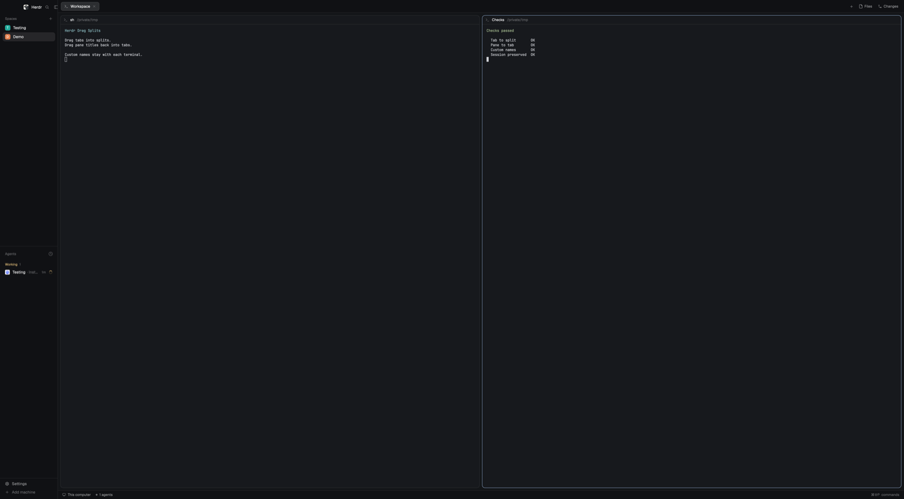

# Herdr Drag Splits

A Herdr layout for moving live terminal tabs into splits and returning a split terminal to a separate tab, with a quiet translucent overlay and preserved custom names.

## What you see

The standard Herdr sidebar, tab bar, terminal cards, Files/Changes panel and status bar. The custom tab bar is 42px tall; pane headers are 30px tall. Dragging opens a full-window overlay with a `#0b101c33` tint. The selected section has a translucent `#d9dde52e` background. No arrows, circles or instruction labels are drawn. Left and right sections span the full height.

## How it behaves

Only the tab right-click menu’s New tab action opens Codex with `--dangerously-bypass-approvals-and-sandbox`. Filter `--no-daemon` out of the suggested command to keep normal Codex daemon behavior. The + button opens the original tab-type selector, and Cmd+T keeps its original plain-terminal behavior. Resolve the configured Codex launcher through `knownAgents` and let the target machine’s shell find it. Do not hardcode a ChatGPT-bundled executable; a portable config must use the same configured command on each target.

Drag a single-terminal tab down from the tab bar to split it beside another tab's focused pane. Left/right thirds select horizontal placement; the upper/lower thirds of the middle column select vertical placement. The center cancels. Release commits the move; Escape cancels. Drag a split pane's title to detach it; its overlay accepts the top 12% of the window, with a 72px minimum.

The existing tab/header status treatment remains: a native spinner for working, a blocked indicator for attention, a done dot and ordinary idle titles. Custom names follow the terminal across moves and appear in its pane header. Header buttons still split, zoom and close panes. Root `movable: false` hides Herdr’s fixed top grip. A bottom-center grip in `drag-pane` opens a transparent layout overlay built from the core tab tree. `pane-drop-zone` targets swap on center drops, rearrange on edge drops, or detach on the tab strip.

Notes are always displayed for terminal panes; there is no Show/Hide menu item. The frame header uses `position: "bottom"`. An always-editable plain-text textarea is drawn inside `drag-pane` below the terminal and above the 30px title strip, with no label or mode controls. Existing note UUID keys are retained. New terminals save under `agent-notes.text.terminal:<address>` until they receive a UUID, at which point saved text migrates without loss. There is no separate pane to move. The tab bar sets the shared frame height from `agent-notes.notes-height`, defaulting to the minimum 70px, capped at 600px. Herdr still shares this frame height across panes.

## Built from

Clone Herdr's `main` layout, `tabs` mod and `pane` mod as `drag-splits`, `drag-tabs` and `drag-pane`. Point the layout's tab bar and pane header at the clones. Clone the shipped menu as `codex-tab-menu` and route its New tab action to `drag-tabs.new-codex`; the custom tab bar opens this menu on right-click. Set the layout root’s `terminal_menu` to `codex-tab-menu`, and use it for header right-clicks too. Its notes action targets the clicked terminal, not the focused one. Add `tab-drop`, opened as a frameless window overlay at `(0,0)` with explicit viewport dimensions adjusted for app zoom. Use mouse events for drag detection and overlay selection, with an overlay focus handle for Escape.

The helper `mods/tab-drop/move.py` uses `herdr-app ls`, `terminal.park`, `terminal.keep`, `tab.select`, `pane.focus`, `pane.swap`, `pane.zoom` and `tab.rename`. It waits for pending model changes, and retries transient missing-terminal responses after parking. Use `hc get` and `hc label` to retain the custom name as `herdr.drag-tab-name`. Store explicit names only; clearing a tab name must clear its saved metadata on the next move. Native spinner assets and the cloned SVG toolbar icons supply the art.

## Watch out

Do not edit shipped Herdr files. Clone them and reference the clones. Use `checking()` to prevent background command loops during validation. Public `run()` calls queue commands; they do not await core acknowledgements. The Python helper must wait before proceeding. A parked terminal remains alive; closing a pane kills it. Popup overlays can constrain height, so use a frameless window with explicit viewport dimensions. Focus the overlay to receive Escape, and stop mouse presses from dragging the overlay window itself.

Tab-to-split supports one terminal in the source tab, within the same space. Detach currently requires at least two terminal panes. No whole-tree transfer, cross-space transfer or mod-pane transfer. Python 3.8+ and both Herdr CLIs must be installed. Use the shared `lib/python.js` launcher and generated per-mod local copies. Select `py -3` on Windows or `python3` on macOS/Linux directly from `window().platform`. Do not probe or scan interpreters before actions, and never retry a started helper. The scripts have been tested on macOS with Herdr 0.1.16.

## Done when

- All eight mods pass `herdr-app check`.
- Live terminal moves work to the left, right, above and below.
- Detaching creates a separate tab without changing the terminal process ID.
- Explicit names survive repeated moves and subsequent renames; clearing a name clears the saved metadata.
- Escape and releasing outside a destination cancel without moving a terminal.
- The overlay fills the window and the selected side highlight fills its height.
- Installation backs up previous copies and leaves personal session state and settings untouched.

- Notes are always visible, save to disk, and retain their text through native swaps, all four split directions and detach.
- Moving an agent preserves its process ID and name; notes are contained in its header and cannot be left as an orphan companion pane.

- A 6px divider above header notes opens the transparent notes-resize capture overlay. Dragging upward grows the bottom notes section and downward shrinks it, changing the saved header height (70–600px), adjusted for app zoom; Escape restores the original height.

- The terminal/header menu has Rename above Split right. It opens rename-agent, which saves herdr.drag-tab-name and renames a standalone tab too. Split panels keep independent names; detaching restores the terminal name as its own tab caption. Explicitly named tabs never get replaced by an agent’s transient status title.
